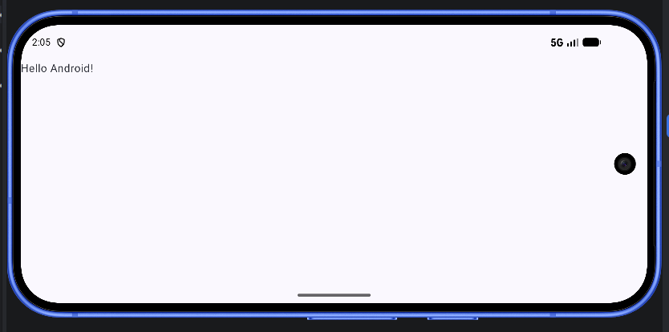
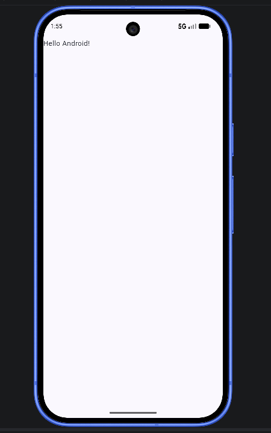
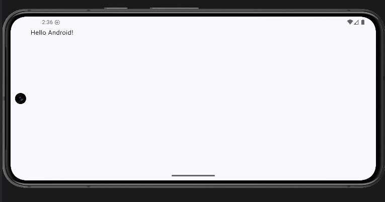
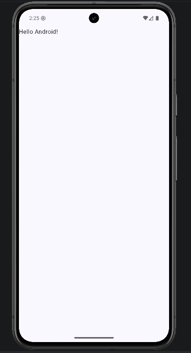
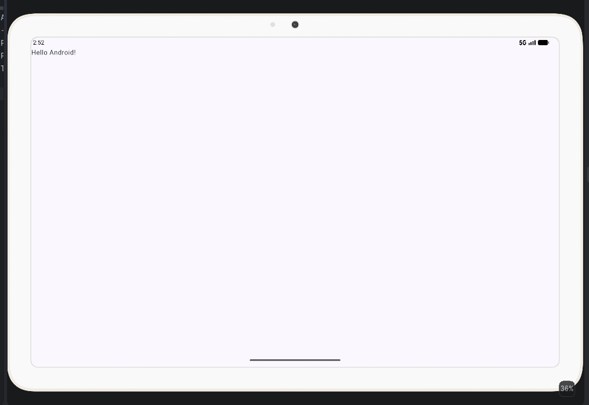
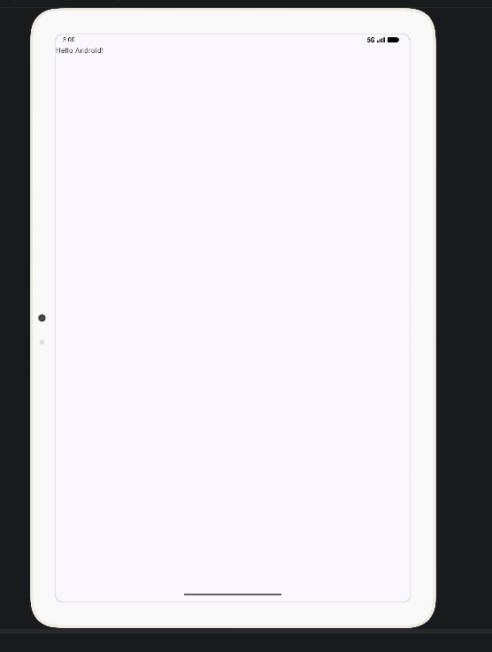

A1.2 · Puesta en marcha del entorno.

| AVD          | API  | Densidad | Resolución |
|--------------|------|----------|------------|
| Pixel 10     | 37.0 | 420 dpi  | 1080x2424  |
| Pixel 8      | 36.0 | 420 dpi  | 1080x2400  |
| Pixel Tablet | 37.0 | 320 dpi  | 2560x1600  |

AVD 1 — Pixel 10.

AVD 2 — Pixel 8.

AVD 3 — Pixel Tablet.

 Diferencias por caracteristicas de hardware y a la configuración de cada emulador. El Pixel 10 ha respondido rápidamente,
el Pixel 8 ha sido más lento y ha mostrado una calidad gráfica peor, mientras que la Pixel Tablet 37.0
ha ofrecido la respuesta más rápida al cambio de orientación. En los tres dispositivos se ha mostrado correctamente
el mensaje «Hello Android!».