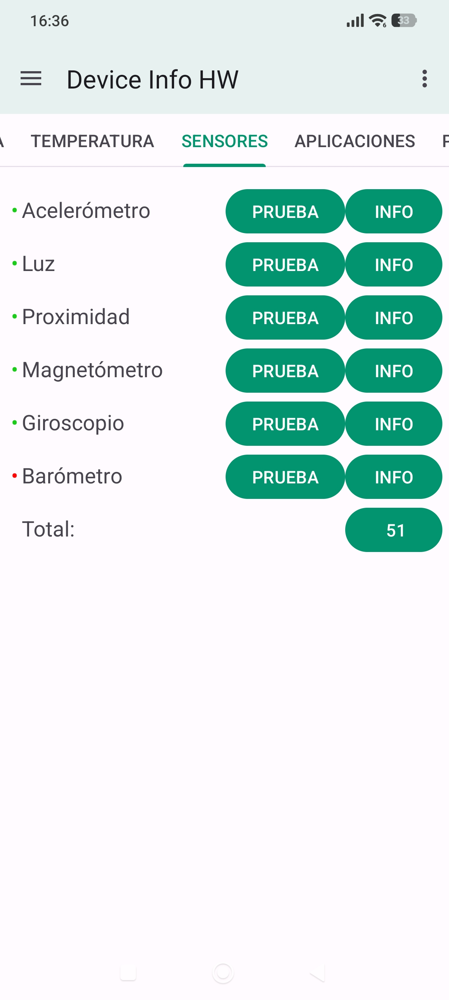

A1.3 · Análisis de limitaciones de un dispositivo.

 Especificaciones.
Procesador :  Qualcomm Snapdragon 8+ Gen 1
RAM :  12 GB
Almacenamiento libre :  166,1 GB
Pantalla :  6,67 pulgadas - 2712×1220 – 446 dpi
Versión de Android: Android 15
Nivel de API: 35
Número de compilación: AQ3A.250226.002

 Sensores Disponibles.

Acelerómetro.
Giroscopio.
Sensor de proximidad.
Sensor de luz ambiental.
Brújula o magnetómetro.
Sensor de huellas dactilares.

 Conclusiones de diseño.

1.Decisión de diseño teniendo en cuenta RAM y procesador, utilizar imágenes en caché, animaciones moderadas, evitar efectos gráficos innecesarios que aumente el consumo.
2.Evitar consumo innecesario de batería, controlar los permisos de acceso de sensores.
3.Las pantallas permiten mostrar ilustraciones detalladas, abastecer con alta resolución.
